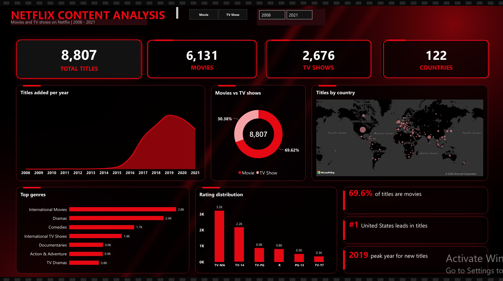
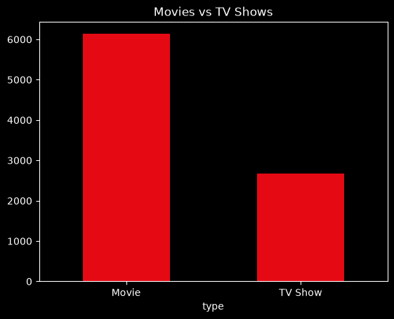
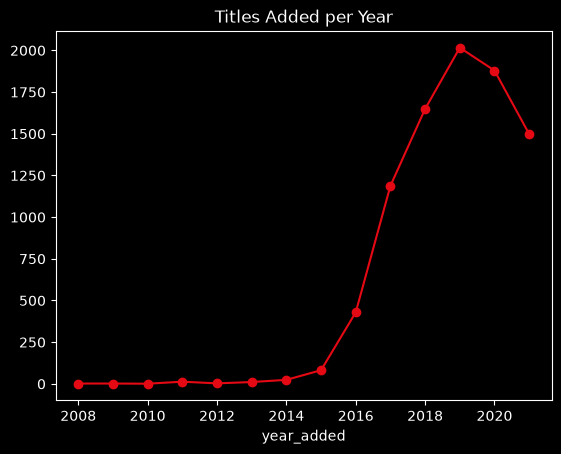
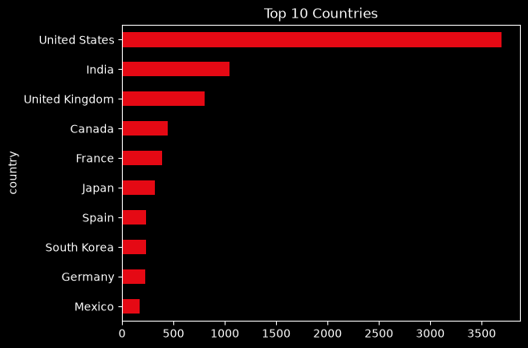
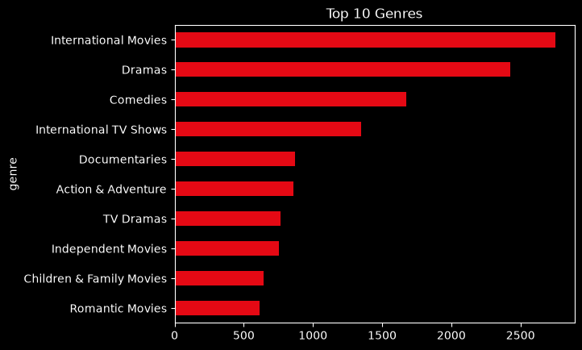
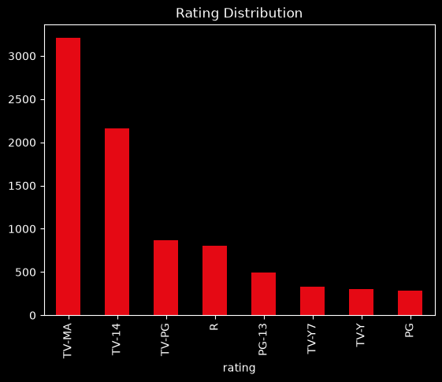

# Netflix Content Analysis (Python + Power BI)

An end-to-end data analytics project: Netflix movies and TV shows data cleaned and analysed in **Python (pandas)**, then turned into a one-page interactive **Power BI** dashboard with key insights.

## Objective
Understand what content Netflix has, where it comes from, how it has grown over the years, and which genres and ratings dominate.

## Dataset
- Netflix Movies and TV Shows dataset from Kaggle: https://www.kaggle.com/datasets/shivamb/netflix-shows
- 8,807 titles, 12 columns
- Key columns: show_id, type, title, director, cast, country, date_added, release_year, rating, duration, listed_in, description

## Tools
- Python (pandas, matplotlib, seaborn) in Jupyter Notebook (cleaning and analysis)
- Power BI Desktop (data model, DAX measures, interactive dashboard)
- GitHub

## Project workflow
1. Loaded the dataset in Python and checked its shape, data types, missing values and duplicates
2. Cleaned the data (see Data cleaning below)
3. Split the multi-value country and genre columns into separate tables
4. Created exploratory charts in Python (see `images/`)
5. Loaded the cleaned tables into Power BI and connected them using `show_id` (one-to-many relationships)
6. Wrote DAX measures and built a one-page dashboard
7. Wrote key insights

## Data cleaning
- Checked for duplicate rows and removed them
- Fixed rows where the movie duration was stored in the rating column
- Filled missing director, cast, country and rating values with "Unknown"
- Converted `date_added` to a proper date and created `year_added` and `month_added`
- Split `duration` into `duration_num` and `duration_unit` (min / Seasons)
- Split `country` and `listed_in` (genre), which hold several values in one cell, into separate rows and saved them as `netflix_countries.csv` and `netflix_genres.csv`

## Python analyses
Movies vs TV shows, Titles added per year, Top 10 countries, Top 10 genres, Rating distribution, Peak year, Most common rating, Average movie duration.

## Power BI dashboard

The dashboard is one page with a custom red and black theme, and slicers for content type and year.

| Visual | Question it answers |
|---|---|
| KPI cards | How big is the Netflix catalogue? |
| Titles added per year (area chart) | How has the catalogue grown over the years? |
| Movies vs TV shows (donut chart) | What is the split between movies and TV shows? |
| Titles by country (map) | Where does the content come from? |
| Top genres (bar chart) | Which genres dominate? |
| Rating distribution (column chart) | Which audience ratings are the most common? |
| Insight tiles | What are the main takeaways? |

DAX measures: Total Titles, Total Movies, Total TV Shows, Total Countries.

## Python charts

### Movies vs TV shows

### Titles added per year

### Top 10 countries

### Top 10 genres

### Rating distribution

## Key findings
- The dataset has 8,807 titles: 6,131 movies (69.6%) and 2,676 TV shows (30.4%)
- Content comes from 122 countries, and the United States has the most titles
- International Movies is the biggest genre, followed by Dramas and Comedies
- Most titles were added in 2019, the peak year in the dataset
- TV-MA is the most common rating, followed by TV-14
- The average movie runs about 99.6 minutes

## Repository structure
- `data/`: `netflix_titles.csv` (raw data), `netflix_clean.csv`, `netflix_countries.csv`, `netflix_genres.csv`
- `notebook/netflix_analysis.ipynb`: Python cleaning and analysis
- `power bi/NETFLIX_ANALYSIS.pbix`: Power BI report (open with Power BI Desktop)
- `images/`: dashboard screenshot, PDF export and Python charts

## Note
I used AI tools for guidance and to design the dashboard background image. The data cleaning, analysis in Python and the Power BI report were built and run by me.

## Author
Nandana Gopan | [LinkedIn](https://www.linkedin.com/in/nandana-gopan-a6b136359/) | nandanagopan2504@gmail.com
